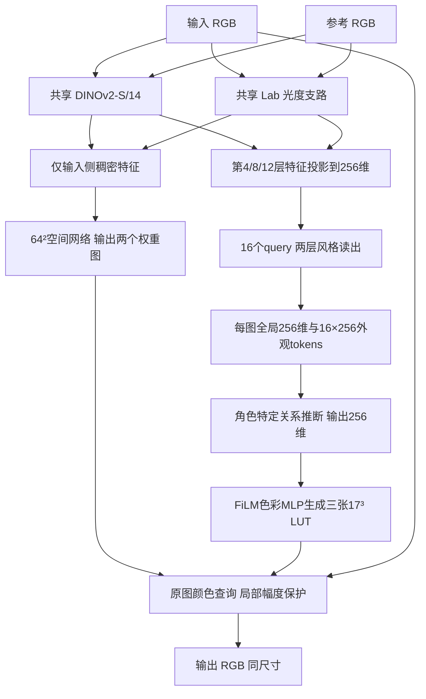

> Historical V2 fixed-map architecture (27,233,197 parameters). V2.1 now defaults to pair-conditioned spatial maps (27,315,437). See Model/V2_1_README.md and Model/v2_1_architecture_report.json.

# v0.2：完整架构、张量尺寸与精确参数

日期：2026-10-30。状态：架构实现、实例参数统计与CPU结构/反向测试完成。尚未下载或加载DINOv2预训练权重，尚未训练v0.2或评测画质。本轮不是已训练模型发布。

实现：Model/tone_model/v2.py；可复现统计：Model/inspect_v2.py；机器可读记录：Model/v2_architecture_report.json。v0.1保留为独立基线，未覆盖。

## 1. 确定的整体设计

以公开DINOv2 ViT-S/14为共享视觉骨干，增加原始Lab光度支路、多层风格读出、角色特定关系推断和输入专属空间上下文。条件色彩MLP在颜色网格上生成一个全局、两个局部17³ LUT；不用大flatten全连接头预测所有顶点。

这是按调研形成的可检验设计，不将共享骨干、attention、统计、FiLM或LUT分别宣称新颖。默认关闭v0.1显式投影，保留none/mean/color开关作独立实验。新编码器先于投影机制确定。



共享意味着同一模块和权重用于输入/参考；参数计一次，但通常执行两次。输入和参考角色在关系模块内有方向，不要求互换对称。

## 2. 整网精确参数

| 模块 | 参数量 | 占比约 |
|---|---:|---:|
| 共享摄影编码器 | 25,162,624 | 92.4% |
| 成对关系推断 | 1,644,032 | 6.0% |
| 输入专属空间上下文 | 276,258 | 1.0% |
| 条件色彩MLP及FiLM头 | 149,769 | 0.55% |
| 局部门控头 | 514 | <0.01% |
| **合计** | **27,233,197** | **100%** |

FP32仅参数约103.9MiB，不含激活、优化器、CUDA上下文、checkpoint容器或骨干执行成本。所有冻结参数仍计入总量。动态LUT顶点/激活不是额外持久可训练参数。

## 3. 共享摄影编码器：25,162,624参数

| 组成 | 输入→输出 | 参数 |
|---|---|---:|
| 官方DINOv2 ViT-S/14 | RGB280²→第4/8/12层，各401×384 | 22,056,576 |
| Lab光度CNN | Lab256²→多尺度特征 | 314,624 |
| 三层视觉特征投影 | 每层384→256，CLS/patch共享该层投影 | 295,680 |
| 三层光度特征投影 | 64/128/192→256 | 99,072 |
| 四类统计投影 | 32/256/30/8→256 | 84,480 |
| 来源类型embedding | 10×256 | 2,560 |
| 学习query | 16×256 | 4,096 |
| 两层TransformerDecoder读出 | query16×256，memory1399×256 | 2,106,880 |
| token LayerNorm | 256维 | 512 |
| 全局读出头 | 512→256→256，含LayerNorm | 198,144 |
| **合计** | 每图16×256 tokens及256维全局向量 | **25,162,624** |

### 3.1 官方视觉骨干

- 官方工厂dinov2_vits14，12 blocks，hidden384，6 attention heads，FFN1536，patch14；无register tokens，不加载分类头。
- 输入/参考各自条件图缩放到280×280，形成20×20 patch，加CLS共401 token。
- 取0-based索引3/7/11，即第4/8/12层，get_intermediate_layers(return_class_token=True, norm=True)。
- 同层CLS和patch使用同一个384→256投影，不为CLS重复建头。不同层的三个投影独立。
- 保留官方518训练尺寸对应的pos_embed：[1,1370,384]；280推理通过插值使用，不能为统计方便改成280构造，否则权重shape和参数量都会变。
- 官方代码固定commit：7764ea0f912e53c92e82eb78a2a1631e92725fc8；来源https://github.com/facebookresearch/dinov2。
- 输入按RGB固定ImageNet均值/方差规范化。Lab不是直接送进DINO；固定归一化也不等于逐图InstanceNorm。

这是一种通用视觉初始化选择，不能宣称它已经具备摄影风格表征。实际使用前必须加载官方预训练权重，随后做任务适配。当前pretrained=False只用于结构统计；工厂默认拒绝无权重运行，除非显式allow_uninitialized=True作烟测。

### 3.2 光度CNN

输入RGB另缩放256²后转归一化Lab。该支路不采用逐图归一化抹掉光度统计。

| 层 | kernel/stride | 输出(C,H,W) | 参数 |
|---|---|---|---:|
| Conv+GELU | 3×3 /2，3→32 | 32×128×128 | 896 |
| Conv+GELU | 3×3 /2，32→64 | 64×64×64 | 18,496 |
| Conv+GELU | 3×3 /2，64→128 | 128×32×32 | 73,856 |
| Conv+GELU | 3×3 /2，128→192 | 192×16×16 | 221,376 |

后三层分别池化到8×8，各64 token，线性投影256维，共192 token。64×64的64通道特征同时供输入上下文复用。

### 3.3 固定光度统计

四类统计并行提取、各自投影成一个256维token：

1. L亮度软直方图：32维。
2. ab联合软直方图：16×16=256维，用可分离权重einsum实现，避免N×16×16全广播。
3. 6个亮度区间：每区a/b均值、a/b标准差与占比，共6×5=30维。占比用于区分该区间有没有证据。
4. 全局Lab均值/标准差6维，加局部亮度差均值/标准差2维，共8维。

固定提取没有可训练参数；四个投影共84480参数。统计仍受物体固有色和场景面积影响，不当作纯风格。

### 3.4 两层query读出

memory序列：三层DINO各401 token=1203；三层光度各64=192；四类统计4；共1399个256维token。来源类型embedding区分10种输入来源，但不额外加入画面xy坐标。

16个学习query连续经过两个decoder layer。每层含query self-attention、query-to-memory cross-attention、FFN和3个LayerNorm；8 heads，每头32维，FFN256→1024→256，GELU，dropout0，norm_first=True。每层1,053,440参数，不能只统计4096个query参数。

最终16×256 token经LayerNorm，均值/std合成512维，再经LayerNorm和512→256→256得到全局描述。query没有预设“人像/天空/高光”等人工语义，是否形成有用分工需验证。

由于DINO内部有位置编码与跨patch交互，v2不再承诺整图patch重排严格不变；query聚合顺序性质不能消除其输入token中已经携带的位置/内容信息。

## 4. 成对关系推断：1,644,032参数

| 分支 | 结构 | 参数 |
|---|---|---:|
| 全局关系 | [zc,zr,zr-zc,zc*zr]1024→512→256 | 656,128 |
| token交互 | 输入tokens作Q、参考tokens作K/V，8-head cross-attn＋FFN1024＋3个LN | 790,272 |
| token差异读出 | 256→256 | 65,792 |
| 融合 | 两路concat512→256＋GELU＋LN | 131,840 |
| **总计** | 输出256维 | **1,644,032** |

这里只交互聚合后的16个外观token，不把参考原始空间特征直接交给高分辨率生成器。cross-attention是明确baseline，不预设优于MLP；pair_attention=False时整个token交互路径不注册，关系模块缩为656128参数。两层读出也可消融为一层。

## 5. 输入专属上下文：276,258参数

输入最后一层DINO patch恢复为384×20×20，经1×1卷积变128通道，上采样到64²。拼接输入光度CNN的64×64×64特征，以及RGB/亮度/局部亮度差/梯度6通道，共198通道。

| 层 | 输出 | 参数 |
|---|---|---:|
| DINO adapter 384→128，1×1 | 128×20×20 | 49,280 |
| Conv198→96，3×3＋GN＋SiLU | 96×64×64 | 171,360 |
| Conv96→64，3×3＋GN＋SiLU | 64×64×64 | 55,488 |
| Conv64→2，1×1＋tanh | 2×64×64 | 130 |

DINO内部有位置先验，即使颜色常量图也可能产生非恒定特征。因此额外用输入全图RGB通道内std构造整体支持系数min(1,mean_std/0.05)：完全常量输入关闭局部路径，低变化输入抑制局部作用。这是无参数安全启发式，可令flat_field_scale=0作消融；不保证普通照片无光点、光晕或伪边缘。

空间图仅来自输入及其特征；参考通过颜色操作与图像级门控产生影响，不直接决定空间权重。

## 6. 颜色操作：149,769＋514参数

条件色彩MLP：RGB坐标3→128→128→9。两个hidden层使用SiLU，条件向量分别产生gamma/beta做FiLM，9个输出对应全局RGB＋两组局部RGB。

| 组成 | 参数 |
|---|---:|
| 基础颜色MLP（3→128→128→9） | 18,185 |
| 条件FiLM head（256→512） | 131,584 |
| **颜色生成总计** | **149,769** |
| 独立门控256→2＋sigmoid | 514 |

MLP在17³颜色网格评估一次，生成一张全局和两张局部LUT，共44217个动态标量。它们是当次预测结果，不是新增44217个持久权重。全局以恒等映射加tanh残差，范围上限1.0，避免前版0.3过早限制强编辑；局部顶点上限0.15，最终局部修正保守上限0.15。上限仍需通过验证检查，不声称已最优。

颜色输出层零初始化，初始模型近恒等；这不是调色效果。所有映射头都可以从图像监督学习；第一次反向时零输出层可能暂时阻断重建梯度到上游，因此表征适配阶段要有实际表征目标，不能仅设置requires_grad就认为训练已经发生。

原图RGB查询三张LUT并按空间权重和门控组合。默认projection=none；mean/color仅作独立对照。局部残差统一幅度保护；可选投影的性质仍仅定位在代理空间、有限颜色基和裁剪前。最终裁剪到[0,1]仍可能产生色带/对比度损失。

## 7. 冻结与适配的精确口径

| 代码stage | 可训练参数 | 冻结参数 | 用途 |
|---|---:|---:|---|
| encoder | 3,106,048 | 24,127,149 | 仅非骨干的共享摄影编码模块；需要另接表征训练目标 |
| heads | 5,176,621 | 22,056,576 | 骨干冻结，其余网络参与联合任务 |
| joint | 12,278,317 | 14,954,880 | 解冻ViT最后4个block和最终norm，加所有新模块 |
| full | 27,233,197 | 0 | 全量适配对照，不作为默认首步 |

joint增加7,101,696可训练参数，来自最后4块7,100,928＋norm768。其余早层、patch embedding、位置参数等仍冻结。冻结通过requires_grad实现，骨干保持eval以固定随机行为；eval不等于禁止可训练块反传。仅完全冻结骨干时其计算使用no_grad，投影/光度/读出不被包入no_grad。

此stage接口只控制可训练集合，不是完整预训练/训练日程实现。权重加载成功、表征损失、数据划分与独立评测都仍需训练流程接入。

## 8. 本轮验证、复现与尚未完成的部分

执行：

```powershell
python Model/inspect_v2.py --structure-only --smoke
python -m unittest discover -s Model/tests -p test_v2.py -v
```

7项结构测试通过：精确参数/stage计数、权重需求保护、张量形状与初始恒等、冻结模式、参考改变关系条件而不改变输入空间图、读出梯度、常量输入局部关闭。真实前向memory1399、风格tokens[1,16,256]、条件[1,256]、空间图[1,2,64,64]、全局LUT[1,3,17,17,17]、局部LUT[1,2,3,17,17,17]。

没有下载官方权重，没有用随机骨干做真实质量实验，没有启动Trinity任务。V2目前只有可运行结构/前向和参数报告；V1 train.py/infer.py仍对应V1，不应直接拿它们训练V2。V2尚未接入正式训练CLI或CPU原图流式部署接口，完整Tensor forward显存随图像尺寸增长；行分块只限制部分临时查询开销。

源代码来自官方仓库并保留其Apache-2.0 LICENSE和版权；本项目新增模块不冒充官方模型。任何“适配后的摄影编码器”结论必须在真实预训练权重和摄影任务训练后验证，当前随机结构实例只用于参数与图验证。
