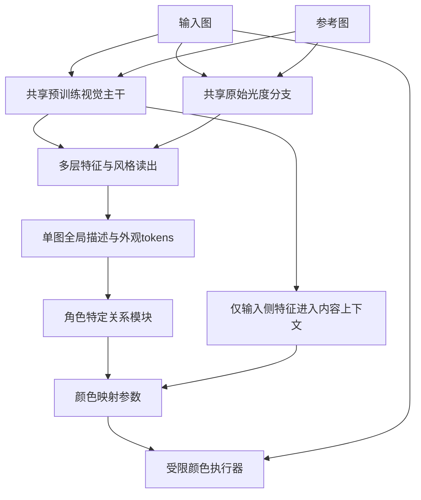

# 共享风格编码器重设计：证据、取舍与下一版设计

日期：2026-10-30。性质：针对用户对v0.1架构的质疑重新进行的文献与设计复核。当前没有实现或训练v0.2，没有下载新骨干权重，没有修改v0.1网络行为。原型保留为基线，不再视为已经定型的投稿架构。

配套核查：[风格编码器文献复核](风格编码器文献复核_20261030.md)、[参考调色架构对照](参考调色架构对照_20261030.md)。前者逐项对照PETAL本地原文及CSD/ICTone，后者核对7篇论文与官方源码，其中代码引用固定到commit。下文的建议均是本项目研究判断，不等于文献已经验证本项目效果。

## 1. 对先前设计的纠正

前版先选择有限颜色残差投影，再给它配了128px独立patch MLP和统计池化；对摄影表征的训练依据与跨内容实证不足。把“没有位置编码”当作主要依据不够：固定token排列不变不等于内容独立，更不等于保留了可迁移摄影信息。

总参数1.78M也掩盖了分配问题：风格编码器仅227456参数，全局/局部LUT预测头合计1266273参数。问题不只在规模，还在上下文、显式光度证据、训练关系与条件推断。现有flip一致性和gain/exposure margin是弱辅助，不能证明跨内容调色表征成立。

共享权重本身并不是错误。两种角色都是摄影图像，同一套测量尺度有合理动机；Neural Preset、ICTone评分器、PREEN和RefRetouch存在共享路径先例。共享不要求所有任务只有一个head，也不要求交换输入/参考得到相同结果。

## 2. 应吸收的现有设计与不能照搬的部分

| 工作/路线 | 已核实的关键设计 | 吸收的原则 | 不直接照搬的边界 |
|---|---|---|---|
| PETAL | 有上下文的ViT，Lab联合统计注入，CLS与学习聚合，多视图摄影预训练 | 风格编码值得独立训练；像素/统计两种证据互补 | 不复制362M规模，不用其隐藏特征破坏黑盒设定；也不把摄影表征重新命名成新贡献 |
| ICTone Tone Scorer | CLIP初始化共享ViT，preset对比后人类排序校准 | 风格关系需要任务监督和独立检索/排序验证 | 它是评分器，不是12B生成器；自动评分不是本项目必须组件 |
| CSD | 预训练骨干经艺术风格标签和空间增强适配 | 预训练语义特征可以适配，训练标签决定风格定义 | 艺术标签包括纹理/形状，不等于摄影调色；官方权重有复现差异提示 |
| ALADIN | 多层特征中的AdaIN统计用于细粒度艺术风格检索 | 不只读最后一层，可保留浅层外观与中层关系 | 艺术搜索的分组和风格定义不直接适用于摄影 |
| Neural Preset | 共享EfficientNet-B0，归一化与重着色的任务约束 | 小CNN有成熟先例；编辑关系应由训练塑造 | 编码器初始化未核实；中性域并非唯一真实物理分解 |
| SA-LUT | 共享VGG多尺度统计路径，加角色不共享的上下文交互 | 共享单图表征与不对称关系推断可并存 | 参考空间cross-attention不能自动保证无内容泄漏；代码/正文需区分 |
| StatLUT | L分布、ab联合分布、颜色条件亮度与LUT映射 | 显式光度证据应成为强基线 | 无画面坐标仍受物体颜色比例影响；非完整局部摄影表征 |
| RefRetouch | 共享且LoRA适配的SigLIPv2，前后编辑对与颜色MLP | 强骨干需要任务适配；编辑表征可由受限解码器塑造 | 核心参考是before/after对，不是我们的一张完成参考；其差值不能直接照搬 |
| PREEN | 共享CLIP＋低层统计，冻结后适配，编辑参数输出 | 语义预训练与光度证据并用，冻结/微调必须对照 | 输出编辑器参数的监督不同，不能仅把29个参数称整个模型大小 |
| NLUT | 多尺度冻结VGG、AdaIN和LUT生成/复用 | 多层特征与颜色执行分离，生成与应用成本分开计 | 包含测试时调优，不属于我们预期的直接前向成本 |

原始来源见文末与两份配套报告。我们没有独立复现论文数字；部分初始化、代码开放和论文/补充不一致已在配套报告标明。

## 3. 新的编码器设计方向：共享主干，多种证据，角色分开的关系推断

### 3.1 选型目标

编码器应同时做到：识别细微曝光/色温/对比度变化；保留暗部与高光不同色偏等条件信息；减少物体、场景和无关布局对风格距离的主导；为输入图提供可靠局部上下文。单张照片不可能保证唯一恢复编辑过程，所以不采用“纯风格唯一可辨识”目标。

不再给整体模型设2M硬上限。先比较成熟小CNN和约20–30M级的小ViT骨干；再用更大骨干判断是否仍欠容量。最终总参数包括所有冻结权重，具体checkpoint和附加模块须实际统计，不能提前宣布v0.2的精确规模。

### 3.2 共享视觉主干

第一候选族为公开预训练ViT-S（例如DINO小模型）；EfficientNet-B0类共享CNN是另一个必要对照，而不是预先排除的弱模型。CLIP/SigLIP及CSD可提供外部对照，不能由模型名决定谁最好。DINOv3官方提供21M级ViT-S；实际权重可获得性与版本必须先核验。

输入仍按所用预训练模型要求进行RGB和固定归一化，不能直接把Lab照片喂给RGB预训练骨干。另建Lab光度分支。固定ImageNet均值/方差归一化不等于InstanceNorm，不应说它删除了每张图的绝对颜色信息。

取中间层与末层特征进行对照，不只拿最终CLS。保留预训练骨干的位置机制作为初始基线；突然删除它可能破坏已有表示。减少无关布局干扰应主要通过任务训练、读出设计与评测实现。部分局部光照/暗角本就与空间相关，不能要求全部空间变化都不影响编码。

### 3.3 独立保留光度证据

从未经逐图归一化的RGB/Lab保留亮度分布、ab联合分布、不同亮度区间的色度、局部对比度等证据。先用可解释的固定统计基线，再测试可学习浅层光度CNN。

它不是纯风格：海洋和草地的固有颜色仍影响统计；优势是防止所有低层证据都依赖一个主要为通用视觉目标训练的骨干。边缘直方图相同不意味着联合分布相同，前版没有显式保留这一关系。

风格路径不应先把每图均值/方差丢掉而没有统计旁路。使用LayerNorm、GroupNorm或InstanceNorm的影响不能混为一谈，应看保留了哪些信息以及统计是否另有通道。

### 3.4 可学习、多尺度的风格读出

候选是从视觉中间层/末层与光度token提取全局风格描述和少量局部外观token。先比较CLS、均值/统计拼接和可学习query聚合；不预设query attention必胜。输出可以是一个256维级全局向量与若干外观token，维度是实验起点，不是风格本质的自由度。

单图编码器输入与参考共享。成对关系模块再解释“当前输入状态→参考期望状态”，它可以使用角色特定head。直接把embedding相减只是基线，不将其当作已经可辨识的编辑量。比较concat MLP和外观token交互时保持下游执行器固定。

输入图的稠密特征可复用于内容上下文；参考图的稠密空间图不直接送入高分辨率RGB生成器。该分工限制直接复制参考布局，但全局条件仍可能带来错误调色，不宣传零幻觉。

这只是优先验证的重设计方向，不是已实现新网络，也不是已证明的新颖组件组合。原v0.1投影机制降为渲染端独立消融，不能主导编码器选型。

## 4. 编码器训练不能省略

阶段A：固定图像分组建立probe。先测统计、当前原型、通用预训练骨干及可用的任务风格表示，找出是否缺低层信息、上下文或摄影适配。

阶段B：摄影任务适配。比较只训练读出器、轻量adapter/LoRA与适度解冻骨干。正例限于有依据的重叠视图/弱空间变换；同内容可控摄影编辑用于区分细调色。控制编辑量是辅助实验真值，不等于所有场景经过同预设后感知风格相同。

阶段C：与固定颜色执行器联合训练，检查参考有效性。现有X/R/Y提供监督，但生成目标不等于人工真值。相同R下不同X的多个输出可提供带噪参考关系，需质量筛选，不能一律当完美正例。用户的keep/reject只提供审核信号，不是完整人工排序；如果确需排序任务，应另收集真实标注。

不要因为把统计喂给融合网络，再从融合向量重建同一统计，就宣称视觉骨干学会光度。若使用这种辅助项，需排查原样拷贝旁路，可从融合前视觉特征预测或做分支遮蔽对照。也不要所有其他图都当风格负例，会把相似调色错误推开。

所有骨干仍是本项目公开可用的通用初始化；不使用PETAL私有数据、编码器权重或中间特征训练本模型，维持其仅提供输出图像的黑盒设定。

## 5. 首轮必须回答的实验

固定全局渲染头，暂关闭复杂局部路径和投影，以免将表征和执行器一起改动。训练/验证源图组保持隔离，不启用最终test调参。

| 对照 | 目的 |
|---|---|
| Lab联合/条件统计 | 获得无语义骨干的强下限 |
| 当前v0.1与成熟小CNN＋统计 | 区分独立patch设计与小规模本身 |
| 小ViT冻结读出＋统计 | 测通用预训练特征本身是否提供收益 |
| 同骨干摄影适配＋统计 | 量化任务适配的独立收益 |
| 同骨干适配但无统计旁路 | 排除性能主要来自旁路 |
| 共享head与角色head | 检查同一尺度与角色差异的取舍 |

指标至少覆盖：同内容调色敏感性；跨内容检索/人工色调排序；局部光照证据；布局扰动稳定；固定输入多参考输出；参考置乱/固定/去掉的消融；特征方差与有效秩。t-SNE和单一内容分类probe不能单独证明解耦。

为了避免自相矛盾，不把相同preset ID当最终风格真值，也不把完全不变的向量当解耦成功。局部参考裁剪可能真的移除风格证据，应区分温和布局扰动与删除风格区域。

## 6. 预先承诺的取舍条件

- 摄影适配若不能提高独立风格probe或参考迁移质量，不因使用了ViT就保留它。
- 增加统计旁路若足以解释全部改善，不把效果归因于更强视觉理解。
- 共享/非共享只在同预算下作结论；共享参数不是创新或错误的先验标签。
- 若打乱参考不改变结果，优先修监督和条件依赖，而不是继续加大模型。
- 若强encoder仍远低于简单渲染oracle，查关系推断；若oracle也很差，查执行器容量/幅度上限。
- 独立外部调色/真实照片盲评必须和合成目标误差分开，防止只证明拟合生成器。

## 7. 本轮主来源

- PETAL用户本地PDF：Reference Papers/PETAL_Enlightening_Photographic_Style_Transfer_ECCV2026.pdf；https://petal-pku.pages.dev/
- ICTone：https://arxiv.org/html/2604.16114v1
- CSD：https://arxiv.org/html/2404.01292v1；https://github.com/learn2phoenix/CSD
- ALADIN：https://openaccess.thecvf.com/content/ICCV2021/papers/Ruta_ALADIN_All_Layer_Adaptive_Instance_Normalization_for_Fine-Grained_Style_Similarity_ICCV_2021_paper.pdf
- Deep Preset：https://arxiv.org/html/2007.10701v2
- Neural Preset：https://arxiv.org/html/2303.13511v1
- SA-LUT：https://arxiv.org/html/2506.13465v1；https://github.com/Ry3nG/SA-LUT
- StatLUT：https://arxiv.org/html/2607.08227v1
- RefRetouch：https://tememuruts.github.io/RefRetouch-Project-Page/；https://tememuruts.github.io/RefRetouch-Project-Page/refretouch-paper.pdf
- PREEN：https://arxiv.org/html/2610.36896v1
- NLUT：https://arxiv.org/html/2303.09170v1；https://github.com/semchan/NLUT
- DINOv3官方骨干：https://github.com/facebookresearch/dinov3
- SigLIP2原文：https://arxiv.org/html/2502.14786v1

部分方法可执行代码/初始化/冻结状态尚有未核项，详见配套报告；这些未知项没有被填成确定事实。此轮完成的是来源核对和设计重排，不是新模型的效果验证。
