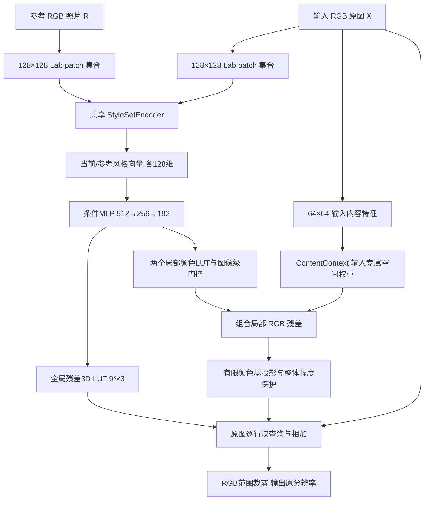

# 参考条件摄影调色模型：完整设计与自审

日期：2026-10-29。版本v0.1。代码：Model/。这是已实现的研究原型，不是已验证有效的新方法或已训练模型；架构创新仍待文献排查和受控实验支持。本文取代候选文档中尚未落实的动态容量主张，不改变60000组候选的冻结划分。

## 1. 决策与研究问题

限定为摄影调色：改变颜色、亮度、对比度与有限局部色调，保留输入图的人物、物体和构图。自有模型不使用扩散、文本模型、预训练大编码器、生成式RGB解码器，也不读取数据生成器的权重、embedding或中间特征。

核心假设：相同有限预算下，明确分离可由低阶全局颜色函数解释的变化与局部变化，能比无分工的局部映射获得更好的优化、泛化或稳定性。首版只研究这一项机制；固定两个局部分支，默认不进行硬动态裁剪。门控是常规条件控制，不作为已成立创新。

## 2. 完整流程与尺寸

默认模型共有1,779,605个可训练参数，包含全部风格编码、条件预测、空间网络与LUT预测头；没有未计入的冻结骨干。FP32参数约6.79MiB，不含优化器、激活和文件容器开销。该数值不是性能或效果结论。

### 2.1 风格集合编码器

输入/参考分别缩放至128×128供条件编码，转D65 Lab并归一化。划分64个16×16 patch；每个768维patch经共享MLP映射到128维。聚合token均值和标准差，再拼接Lab三通道16-bin软直方图与均值/标准差，共310维，经过310→256→128得到风格向量。

没有跨patch卷积、绝对位置编码或额外语义骨干。对**已抽取patch的排列**在数值误差内不变；真实裁剪和缩放可能改变统计，不保证不变。patch内部仍有结构，直方图也受物体颜色影响，因此不宣称纯风格或语义独立。

令当前风格zc=Es(X)、参考风格zr=Es(R)，条件为F([zc,zr,zr-zc,zc*zr])。使用当前风格是因为输入本身已有调色；此设计不声称能唯一恢复其原始编辑参数。

### 2.2 输入专属空间网络

在64×64代理输入上构造RGB、亮度、局部亮度残差、梯度幅值，共6通道。四个3×3卷积块，通道6→48→64→64→64，GroupNorm与SiLU，输出两个tanh空间权重。

参考特征不进入此网络；无坐标通道，卷积使用replicate padding，避免均匀输入因零填充产生边界模板。这样限制参考直接传入空间纹理，但不保证所有实际照片都无伪影。

### 2.3 全局与局部映射

T0(c)=c+0.3*tanh(Dg(z))(c)，每个局部ΔTk(c)=0.1*tanh(Dk(z))(c)。LUT顶点通过三线性插值查询。两个门控为sigmoid，初始bias=-2；默认软门控、两个分支均执行。

在代理网格上，Rraw(p)=sum_k gate_k*map_k(p)*ΔTk(X(p))。模型不直接生成RGB空间图，不从参考复制patch；仍可能发生不自然的色彩、对比度和局部明暗变化。

LUT预测头零初始化，因此未训练模型接近恒等。这用于稳定启动，绝不能把初始输出当成有效的风格迁移结果。

## 3. 候选核心：最终RGB残差投影

将RGB归一化为u,v,w∈[-1,1]，建立固定基：

Phi=[1,u,v,w,u²,v²,w²,uv,uw,vw]。

在64×64网格上，B形状4096×10，Rraw形状4096×3。使用FP32 SVD伪逆，rcond=1e-4：

β=B†Rraw，Rperp=Rraw-Bβ。

梯度经过Rraw和β传回模型，但固定输入基的伪逆不求梯度。正交性质针对SVD保留的数值列空间，有限精度和截断使原始全部列的相关性只近似为零。它不等于对全部3D LUT或所有全局色彩变换正交。

必须投影最终RGB残差；只投影mask后再乘颜色函数，性质会失效。投影可能只是参数分工/正则化，不保证扩大表达能力或提高效果。

### 3.1 代理色域外推保护

下采样代理可能缺少原图的极端颜色，β在原图颜色上的多项式外推可能过大。默认对整张图的Rperp施加同一个标量gamma：

U=local_limit*sum(gates)+max_channel sum_j abs(β_jc)

gamma=min(1, local_output_limit/max(U,eps))，local_output_limit=0.1。

因为所有基函数幅度≤1、maps经tanh、局部LUT顶点经tanh且插值为凸组合，对RGB∈[0,1]可得每个像素局部修正幅度≤0.1。gamma对整张图恒定，保持代理空间的数值正交关系。这是局部路径的幅度界，不是零伪影证明；全局映射仍可能造成裁剪或色带。分别裁剪每个残差像素会破坏正交，因此首版不这样做。

### 3.2 原分辨率渲染

代理空间估计的β与gamma在所有原图块共享。空间权重上采样，逐行块查询全局/局部LUT，计算Rraw-B(X)β，再统一乘gamma。最后输出裁剪至[0,1]。

代理投影的正交性质不自动成立于原分辨率；最终RGB裁剪也会改变图像差分性质。iter_render_rows使原图保持CPU uint8，仅上传当前行块；CPU仍需原图和输出存储，临时GPU内存随块宽度变化。普通forward/render仍返回完整Tensor，用于小分辨率训练，不应宣传其总显存与分辨率无关。

## 4. 数据、损失与训练

直接读取Dataset/Photo_Triplets_v1/triplets.json，路径相对JSON目录。冻结train/validation/test，不按三元组重新随机划分；input和reference两侧参与隔离，存在源清单时核对源路径、split、重复组和SHA元数据。元数据检查不代替重新计算图片字节哈希，原始传输完整性已有独立记录。

现有59100训练、400验证、400测试；100同图诊断不参与训练。人工reject仅在样本层排除，不删除共享原图；high_quality-only只筛训练。改变验证筛选会改变验证集合，应在正式实验前冻结审核版本并记录fingerprint。

生成器用thumbnail(max_edge768,LANCZOS)，训练应按generation.max_image_edge复现这一处理，并检查目标尺寸；之后content/target共同缩至训练长边256，参考独立缩至256。batch1保留不同纵横比，无随机裁剪错位。条件网络内部统一网格会缩放纵横比，仅用于参数推断，输出图形不被拉伸。

默认loss：像素L1(1)，目标梯度匹配(0.05)，残差LUT平滑(0.001)，实际局部修正能量(0.001)，输出裁剪前越界(0.01)。不直接强制与原图梯度完全相同，否则会惩罚有效对比度变化。

风格辅助项：参考水平翻转一致性(0.01)，同内容受控曝光/通道增益编辑的敏感性margin(0.01)。margin按实际RGB变化幅度设置，避免对无可见变化样本强迫分离。它们是弱监督常规约束，不保证跨内容同风格对齐、不代表新颖性，也不把所有不同照片视为风格负样本。可用without_style_aux配置消融。

训练建议先全局路径功能与学习检查，再开启局部联合训练，最后对人工优质子集小学习率微调。具体步数和学习率必须由开发验证确定；默认10000步只是启动配置，batch1不等于60000样本已完整训练。无Tone Reward；不声称它已被人工筛选等价替代。

训练支持可选compute-local低分辨率lossless PNG缓存，按三元组文件stat与处理参数分片；冷/暖缓存张量一致，源stat改变会失效。默认关闭。三元组级缓存会重复一些小预览，不复制完整原图。验证指标之外还记录代理相关误差、gamma、投影系数界、裁剪比例和门控诊断。checkpoint恢复优化器和随机状态；CPU同环境恢复逐位一致已经测试，不承诺非确定性CUDA核或跨平台同样逐位一致。

## 5. 已实现文件与对照

Model/tone_model/model.py为网络和渲染；losses.py为损失；data.py为冻结数据与审核选择；train.py为监督训练/验证/恢复；infer.py为checkpoint推理；diagnose.py为target-access oracle诊断；tests/test_model.py为性质与数值测试。

配置：default显式颜色投影；local_unprojected不投影；local_mean仅去均值；local_soft软相关惩罚；global_only无局部分支；without_style_aux去辅助项；unbounded_projection去局部幅度保护。global-only阶段也可关闭局部计算但保持参数形状，用于同架构warmstart。

diagnose使用自由空间RGB场，是宽松渲染能力诊断，不是本模型精确表达上界。它读取目标拟合，只能报告oracle诊断，不混入可部署方法分数；拟合与留出空间块分开，默认只用train或validation。

## 6. 连续自审与停止条件

| 自问 | 结论与处理 |
|---|---|
| 小模型和低分辨率预测是不是新？ | 不是；HDRNet、Neural Preset、StatLUT等已有。总参数与完整开销必须实测。 |
| 无序token是不是纯风格？ | 不是；只保证固定token排列不变。弱辅助项与像素监督仍需跨内容探针验证。 |
| 全局＋局部是不是新？ | 不是；SA-LUT、PETAL、LoopLUT等已有近邻。 |
| 投影是不是增加表达能力？ | 不保证，可能只是正则化或参数分工。必须优于简单去均值、软约束及训练顺序。 |
| 先投影mask是否足够？ | 不够，改为最终RGB残差。 |
| 代理投影会不会原图外推不稳定？ | 会，增加整体gamma界，并消融其独立作用。 |
| 分块是否就低显存？ | 不自动，增加CPU原图逐块上传接口，保留普通训练API边界。 |
| 数据是否已经精确对齐？ | 发现resize/thumbnail默认差异，改为复现生成器处理；其余尺寸不匹配显式报错。 |
| 不用扩散是否零幻觉？ | 不是；需光点/纹理压力测试、clip率、边缘变化和风格符合度共同评价。 |
| 拟合PETAL目标是否意味着真实调色更好？ | 不是；PST50/TST2K、独立真实照片和盲评仍必要。 |

如果显式投影不优于不投影、去均值、soft约束、global预热，停止以投影为核心贡献。如果全局oracle已足够而条件预测差，转向风格条件推断；如果局部收益只能靠减弱风格获得，不作质量优势声明。如果复杂度收益仅相对12B而弱于强轻量基线，不作效率前沿声明。

## 7. 原始来源与边界

- HDRNet：低分辨率参数推断和原图局部仿射应用已有先例。https://groups.csail.mit.edu/graphics/hdrnet/
- SA-LUT：空间自适应参考调色与内容/参考交互。https://arxiv.org/abs/2506.13465
- StatLUT：无空间统计及小型颜色映射。https://arxiv.org/html/2607.08227v1
- PETAL：摄影表征、图像增强自监督与条件神经颜色映射。https://petal-pku.pages.dev/
- PREEN：生成器监督、伪预设与两阶段训练已有先例。https://arxiv.org/html/2610.36896v1
- LoR-LUT：低秩残差已有先例。https://arxiv.org/abs/2602.22607
- LoopLUT：区域渐进细化的相关先例，需进一步对照。https://arxiv.org/abs/2609.33593

上述组件不应各自列为首次。当前候选贡献仅是“受约束的局部/全局分工是否带来可测收益”的方法假设及配套实证；不能据代码完成就宣称满足CVPR录用标准。

## 8. 本次实际验证记录

本地Windows/PyTorch2.12.0 CPU及Trinity计算节点PyTorch2.8.0+cu129均通过22项自动测试，涵盖LUT轴序、初始化恒等、固定patch排列不变、参考不影响空间图、代理投影、退化颜色空间、局部幅度界、平坦场、分块/整图一致、源图划分/路径绑定、thumbnail像素对齐及缓存失效。

训练入口另测试了合成数据2步训练后恢复第3步，与同seed连续3步参数逐张量一致；global-only到joint warmstart、优质筛选和CPU uint8原尺寸推理成功。详见《训练入口验证记录.md》。这些CPU恢复性质不推广为所有CUDA核逐位可重现。

trinity-2-23上实际使用空闲GPU8（2080Ti）与真实train_000001三元组完成3步CUDA兼容性检查，loss约0.104885→0.104425，梯度有限；1920×1289原图流式渲染成功。模型参数1,779,605。调试分辨率下PyTorch峰值allocated约70.8MiB，原图流式环节约79.1MiB；这些不含CUDA上下文等完整进程开销，不是完整吞吐基准，也不能外推画质或其他分辨率的成本。

记录见Model/verification_gpu_final.json及Model/verification_remote_tests.txt。检查结束GPU进程已退出。没有启动正式模型训练、没有发布可用于效果展示的训练checkpoint。原有三元组对比服务保留运行。
